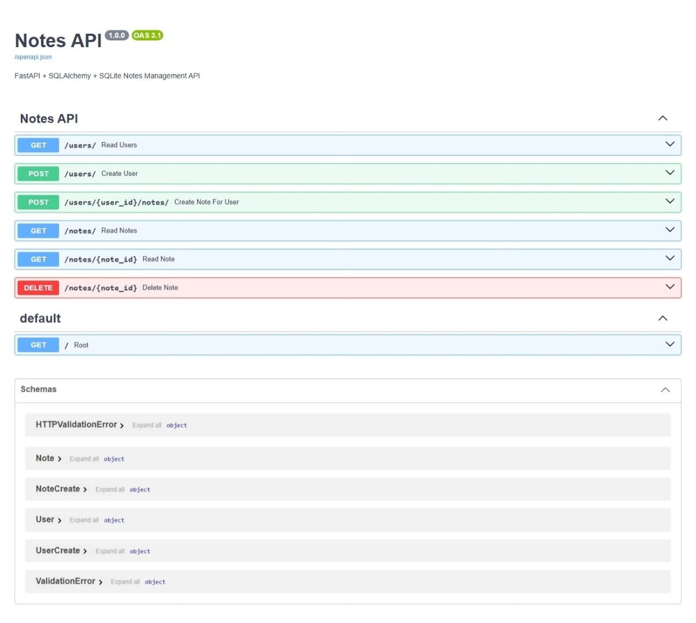
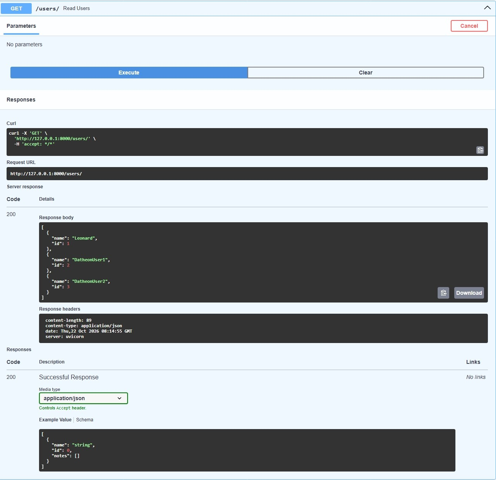
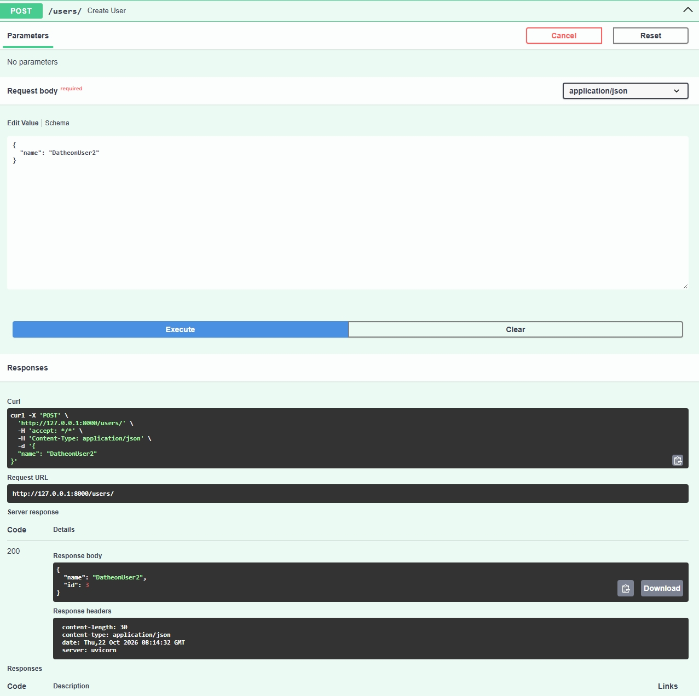
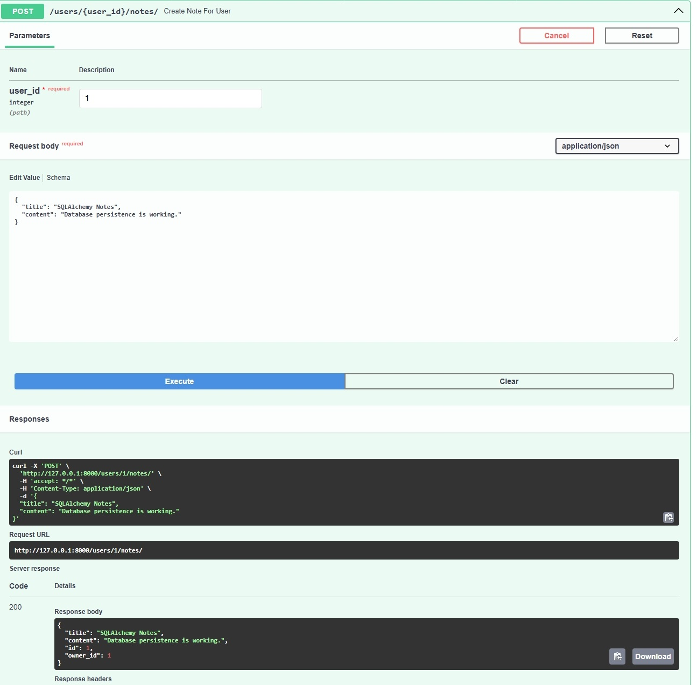
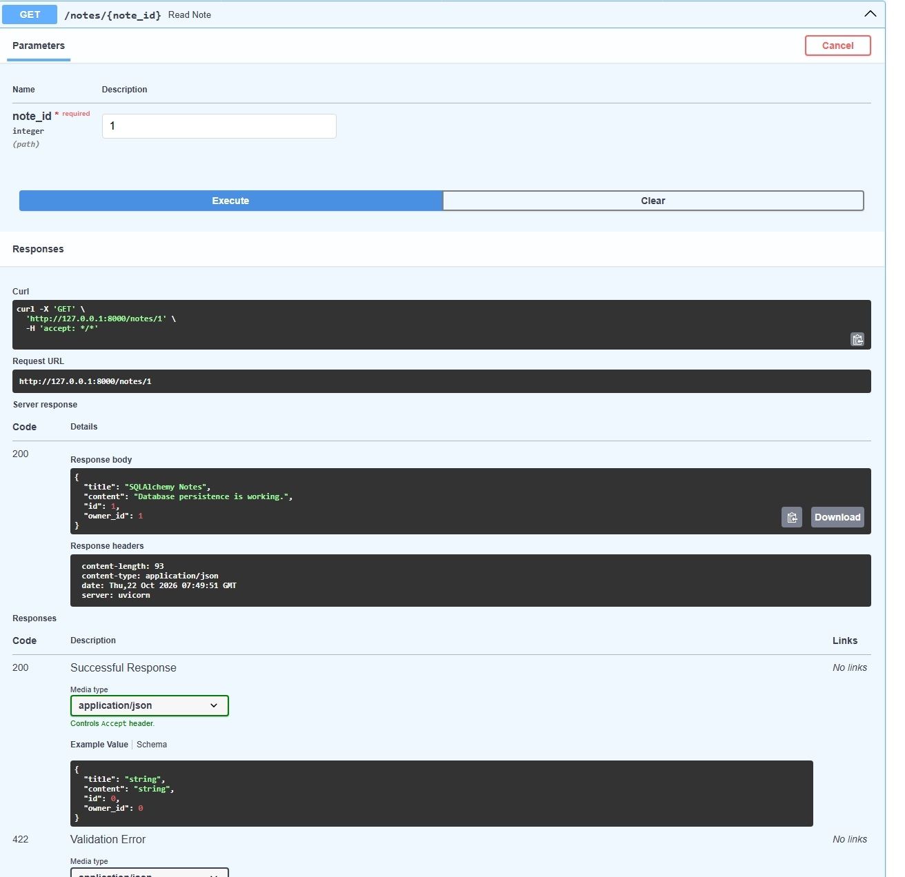
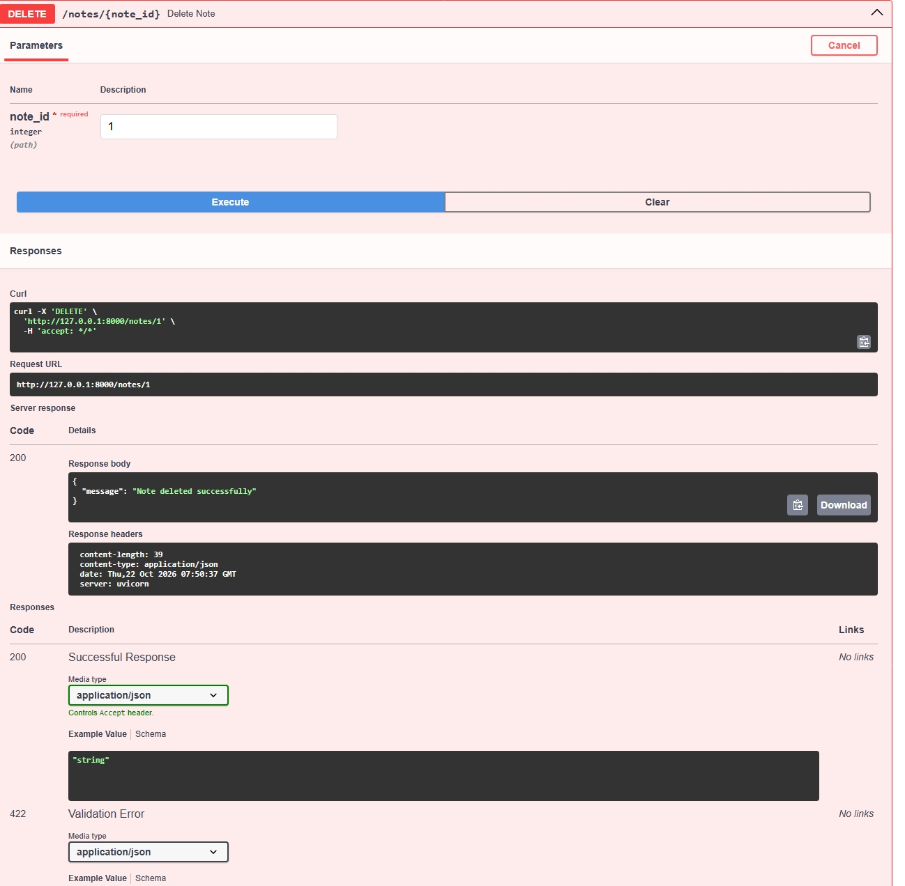

# 📝 FastAPI SQLAlchemy Notes API


---

## 📌 Overview

The FastAPI SQLAlchemy Notes API is a database-driven backend application built as part of the **Python + FastAPI Backend Development Internship** at **Datheon AI Systems & Automation Studio**.

The project demonstrates:

- FastAPI REST API development
- SQLAlchemy ORM usage
- SQLite persistence
- Async database sessions
- Dependency Injection
- Pydantic validation
- OpenAPI / Swagger documentation
- Relational database modelling

---

## 🛠 Tech Stack

- Python 3
- FastAPI
- SQLAlchemy 2.x
- SQLite
- Pydantic v2
- Uvicorn
- OpenAPI / Swagger

---

## 🏗 Architecture

```text
User (1)
   │
   └───< Note (Many)
```

### User

```python
User
├── id
└── name
```

### Note

```python
Note
├── id
├── title
├── content
└── owner_id
```

---

## 📂 Project Structure

```text
fastapi-sqlalchemy-notes-api/
│
├── main.py
├── README.md
├── requirements.txt
├── .gitignore
├── .gitattributes
│
├── app/
│   ├── crud.py
│   ├── database.py
│   ├── models.py
│   ├── routes.py
│   ├── schemas.py
│   └── __init__.py
│
└── notes.db
```

---

## ⚙️ Installation

### Clone Repository

```bash
git clone https://github.com/leonardphokane/fastapi-sqlalchemy-notes-api.git
cd fastapi-sqlalchemy-notes-api
```

### Create Virtual Environment

```bash
python -m venv venv
```

### Activate Virtual Environment

Windows

```bash
venv\Scripts\activate
```

Linux / macOS

```bash
source venv/bin/activate
```

### Install Dependencies

```bash
pip install -r requirements.txt
```

---

## 🚀 Run API

```bash
uvicorn main:app --reload
```

Application:

```text
http://127.0.0.1:8000
```

Swagger:

```text
http://127.0.0.1:8000/docs
```

ReDoc:

```text
http://127.0.0.1:8000/redoc
```

---

# 📖 API Endpoints

## Users

### Create User

```http
POST /users/
```

Request

```json
{
  "name": "Leonard"
}
```

Response

```json
{
  "id": 1,
  "name": "Leonard"
}
```

---

### Get Users

```http
GET /users/
```

Response

```json
[
  {
    "id": 1,
    "name": "Leonard"
  }
]
```

---

## Notes

### Create Note

```http
POST /users/{user_id}/notes/
```

Request

```json
{
  "title": "SQLAlchemy Notes",
  "content": "Database persistence is working."
}
```

Response

```json
{
  "id": 1,
  "title": "SQLAlchemy Notes",
  "content": "Database persistence is working.",
  "owner_id": 1
}
```

---

### Get All Notes

```http
GET /notes/
```

---

### Get Note By ID

```http
GET /notes/{note_id}
```

---

### Delete Note

```http
DELETE /notes/{note_id}
```

Responselemented

- FastAPI REST Architecture
- SQLite Database Persistence
- SQLAlchemy ORM
- Async Database Sessions
- CRUD Operations
- User ↔ Notes Relationships
- Dependency Injection
- Pydantic Validation
- Swagger Documentation
- OpenAPI Specification
- Foreign Key Constraints

---

# 📸 API Screenshots

<details open>
<summary><b>Swagger API Overview</b></summary>



</details>

<details>
<summary><b>GET /users/</b></summary>



</details>

<details>
<summary><b>POST /users/</b></summary>



</details>

<details>
<summary><b>POST /users/{user_id}/notes/</b></summary>



</details>

<details>
<summary><b>GET /notes/{note_id}</b></summary>



</details>

<details>
<summary><b>DELETE /notes/{note_id}</b></summary>



</details>

---

# 🎯 Learning Outcomes

This project helped reinforce:

- Backend API Design
- Relational Database Modelling
- SQLAlchemy ORM
- SQLite Persistence
- Async Python Programming
- Dependency Injection
- Data Validation
- FastAPI Best Practices

---

## 👨‍💻 Author

**Leonard Phokane**


GitHub:

```text
https://github.com/leonardphokane
```

---

© 2026 Datheon Internship. All Rights Reserved.
